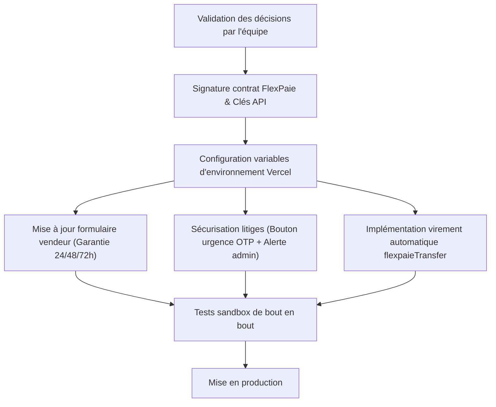

# 📋 NewKet — Décisions d'équipe à prendre
> Document de cadrage stratégique et technique — Flux de paiement & Litiges (NewKet / FlexPaie)

---

## ✅ DÉCISIONS DÉJÀ VALIDÉES

| # | Sujet | Décision | Justification stratégique |
|---|---|---|---|
| **D1** | **Arbitrage des litiges** | **100% humain** | L'admin doit trancher, aucune décision de remboursement automatisée par le robot. |
| **D2** | **Frais de livraison en litige** | **Non remboursés** | Le vendeur assure lui-même la livraison. Le service de transport ayant eu lieu, seul le produit est remboursé. |
| **D3** | **Retour produit** | **Acheteur ramène physiquement** | L'acheteur retourne le bien à l'adresse du vendeur et valide via code OTP. |
| **D4** | **Architecture sans Wallet** | **Pass-through direct** | Pas de solde virtuel retenu sur l'application : fonds virés directement sur le Mobile Money du vendeur. |
| **D5** | **Devise de remboursement** | **Même devise (CDF→CDF, USD→USD)** | Zéro conversion de change pour éviter toute perte de valeur pour l'utilisateur. |
| **D6** | **Garantie vendeur** | **24h / 48h / 72h** | 3 options fixes choisies par le vendeur à la création de la fiche produit. |
| **D7** | **Protection acheteur (100%)** | **Remboursement à 100% du produit** | Stratégie essentielle de confiance et de rétention client. L'acheteur ne subit jamais de retenue de frais. |
| **D8** | **Commission NewKet en litige** | **0% commission** | En cas de litige validé en faveur de l'acheteur, NewKet renonce à sa commission. |

---

## 🔴 POINTS ENCORE OUVERTS (À TRANCHER EN ÉQUIPE)

### 🔴 O1 — Absorption des frais FlexPaie (~4.5%) lors d'un remboursement

**Contexte technique :**
- Payin : FlexPaie prélève **2.5%** lors du paiement de commande.
- Payout remboursement : FlexPaie prélève **2%** pour renvoyer les fonds à l'acheteur.
- Total frais techniques : **~4.5%** irrécupérables auprès de la passerelle.

**Options envisageables :**

| Option | Fonctionnement | Conséquence |
|---|---|---|
| **Option A (Recommandée)** | **Vendeur fautif supporte les frais** | Une dette interne de 4.5% est inscrite sur le compte vendeur et déduite de son prochain versement (payout). |
| **Option B** | **NewKet absorbe les frais** | Pris en charge par NewKet comme coût d'acquisition/garantie client. |
| **Option C** | **Partage des frais** | Partage 50/50 entre le vendeur et la plateforme. |

> [!NOTE]
> FlexPaie ne gère pas de système de compensation différée. Tout mécanisme de déduction est opéré en interne via la base Supabase NewKet avant l'ordre de virement.

---

### 🔴 O2 — Inaction de l'acheteur dans le chat de litige

**Contexte :**
Le robot surveille les délais de réponse :
- Si le vendeur ne répond pas sous 24h : l'acheteur est automatiquement remboursé (sanction pour abandon de SAV).
- Si l'acheteur ne répond pas à l'offre du vendeur sous 24h : le système accepte automatiquement la proposition du vendeur.

**Question pour l'équipe :**
Est-ce qu'on maintient l'acceptation automatique après 24h de silence de l'acheteur, ou l'admin doit-il systématiquement valider avant clôture ?

---

### 🔴 O3 — Dépassement du délai admin (72h)

**Contexte :**
Actuellement, si l'admin n'a pas pris de décision au bout de 72h, le code arbitre automatiquement en fonction du nombre de photos/vidéos fournies.

**Options :**
- **Option A :** Supprimer l'arbitrage automatique et envoyer une alerte urgente par email/push à l'admin (décision 100% humaine préservée).
- **Option B :** Conserver l'arbitrage automatique comme filet de sécurité exceptionnel pour éviter que les fonds restent gelés.

---

### 🔴 O4 — Sécurisation du retour physique (Bouton d'urgence)

**Scénario à risque :**
L'acheteur ramène le produit au vendeur. Le vendeur reprend la marchandise mais refuse de communiquer le code OTP de confirmation. Sans OTP, le délai de 48h expire et le système débloque l'argent au vendeur.

**Solution proposée :**
Ajouter dans l'interface litige un bouton :
> *"J'ai remis le colis mais le vendeur refuse de valider"*
- Action : Arrêt immédiat du compte à rebours 48h.
- Escalade instantanée auprès de l'équipe support NewKet pour vérification manuelle.

---

### 🔴 O5 — Affichage de la garantie sur la fiche produit

**Points d'interface :**
- Rendre la sélection du délai de garantie (24h, 48h, 72h) **obligatoire** lors de la publication d'un produit (défaut conseillé : 72h).
- Afficher un badge visible sur la page produit : *"Garantie NewKet : X heures après réception"*.

---

### 🔴 O6 — Taux de commission NewKet

**Contexte :**
Le taux est actuellement configuré à 0% dans le code en attente de la signature contractuelle avec FlexPaie.
- Définir le pourcentage officiel prélevé par NewKet sur chaque commande validée.
- Fixer la formule de calcul : `Net Vendeur = Montant Produit - Commission NewKet - Frais FlexPaie`.

---

## 🛠️ PLAN D'IMPLÉMENTATION TECHNIQUE

---

## 📌 RÉSUMÉ DES FICHIERS CONCERNÉS

- Séquestre et durées : [`backend/src/controllers/order.controller.js`](file:///C:/Users/tmaut/Downloads/THE%20PHOENIX/NewKet/backend/src/controllers/order.controller.js) & [`backend/src/services/order-workflow.js`](file:///C:/Users/tmaut/Downloads/THE%20PHOENIX/NewKet/backend/src/services/order-workflow.js)
- Gestion des litiges et SLA : [`backend/src/controllers/dispute.controller.js`](file:///C:/Users/tmaut/Downloads/THE%20PHOENIX/NewKet/backend/src/controllers/dispute.controller.js)
- Passerelle de paiement : [`backend/src/services/flexpaie.js`](file:///C:/Users/tmaut/Downloads/THE%20PHOENIX/NewKet/backend/src/services/flexpaie.js) & [`backend/src/controllers/payment.controller.js`](file:///C:/Users/tmaut/Downloads/THE%20PHOENIX/NewKet/backend/src/controllers/payment.controller.js)
- Crons Vercel : [`vercel.json`](file:///C:/Users/tmaut/Downloads/THE%20PHOENIX/NewKet/vercel.json) & [`backend/src/routes/cron.routes.js`](file:///C:/Users/tmaut/Downloads/THE%20PHOENIX/NewKet/backend/src/routes/cron.routes.js)
